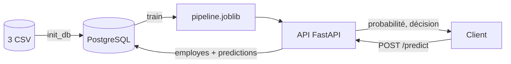
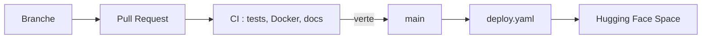

<a id="readme-top"></a>

<!-- PROJECT SHIELDS -->
[![CI][ci-shield]][ci-url]
[![Python][python-shield]][python-url]
[![FastAPI][fastapi-shield]][fastapi-url]
[![scikit-learn][sklearn-shield]][sklearn-url]
[![PostgreSQL][postgres-shield]][postgres-url]
[![Docker][docker-shield]][docker-url]
[![Hugging Face][hf-shield]][hf-url]

<!-- PROJECT LOGO -->
<br />
<div align="center">
  <h3 align="center">Turnover API</h3>

  <p align="center">
    Prédiction du risque de départ des employés : un modèle de Machine Learning exposé par une API REST, déployé en continu.
    <br />
    <a href="https://tessilimic.github.io/turnover_model/"><strong>Explorer la documentation »</strong></a>
    <br />
    <br />
    <a href="#usage">Exemples</a>
    &middot;
    <a href="docs/api/index.md">Référence de l'API</a>
    &middot;
    <a href="https://github.com/tessilimic/turnover_model/issues/new?labels=bug">Signaler un bug</a>
    &middot;
    <a href="https://github.com/tessilimic/turnover_model/issues/new?labels=enhancement">Proposer une évolution</a>
  </p>
</div>

<!-- TABLE OF CONTENTS -->
<details>
  <summary>Sommaire</summary>
  <ol>
    <li>
      <a href="#about-the-project">À propos du projet</a>
      <ul>
        <li><a href="#built-with">Technologies</a></li>
        <li><a href="#architecture">Architecture</a></li>
      </ul>
    </li>
    <li>
      <a href="#getting-started">Démarrage</a>
      <ul>
        <li><a href="#prerequisites">Prérequis</a></li>
        <li><a href="#installation">Installation</a></li>
        <li><a href="#configuration">Configuration</a></li>
      </ul>
    </li>
    <li><a href="#usage">Utilisation</a></li>
    <li><a href="#the-model">Le modèle</a></li>
    <li><a href="#security">Sécurité</a></li>
    <li><a href="#deployment">Déploiement</a></li>
    <li><a href="#documentation">Documentation</a></li>
    <li><a href="#roadmap">Feuille de route</a></li>
    <li><a href="#contributing">Contribuer</a></li>
    <li><a href="#license">Licence</a></li>
    <li><a href="#contact">Contact</a></li>
    <li><a href="#acknowledgments">Remerciements</a></li>
  </ol>
</details>

<!-- ABOUT THE PROJECT -->
<a id="about-the-project"></a>

## À propos du projet

À partir du profil RH d'un employé (SIRH, sondage interne, évaluations), un modèle
**Random Forest** estime la probabilité qu'il quitte l'entreprise. L'API renvoie cette
probabilité et une décision, et **enregistre chaque prédiction** en base de données.

* **Objectif** : aider les RH à cibler les actions de rétention, en détectant un maximum
  de départs (81 % des départs détectés sur le jeu de test).
* **Industrialisé** : pipeline complet exporté, API validée, base de données, 245 tests,
  CI/CD jusqu'au déploiement sur Hugging Face Spaces.
* **Documenté** : Swagger, site MkDocs, référence du code Sphinx, protocole de maintenance.
* **Traçable** : logs JSON reliés par `X-Request-ID`, journal de chaque appel au modèle en base (`GET /logs`).
* **Sécurisé** : comptes et jetons JWT, rôles `rh` / `auditeur` / `admin`, mots de passe Argon2id,
  rôles PostgreSQL à privilèges minimaux, aucun secret dans le dépôt.

> [!WARNING]
> Outil d'**aide à la décision** : environ 7 alertes sur 10 sont des fausses alertes.
> Il ne doit pas fonder seul une décision concernant un employé
> (voir [les limites du modèle](docs/modele.md#limites-et-precautions)).

<p align="right">(<a href="#readme-top">retour en haut</a>)</p>

<a id="built-with"></a>

### Technologies

| Domaine | Outils |
|---|---|
| Modèle | [![scikit-learn][sklearn-shield]][sklearn-url] pandas, NumPy, joblib |
| API | [![FastAPI][fastapi-shield]][fastapi-url] Pydantic, Uvicorn |
| Données | [![PostgreSQL][postgres-shield]][postgres-url] SQLAlchemy (ORM), psycopg, SQLite |
| Déploiement | [![Docker][docker-shield]][docker-url] [![Hugging Face][hf-shield]][hf-url] GitHub Actions, Git LFS |
| Qualité | pytest, pytest-cov, Dependabot |
| Documentation | Swagger (OpenAPI), Markdown, MkDocs Material, Sphinx |

Les raisons de chaque choix sont détaillées dans [Choix techniques](docs/choix-techniques.md).

<a id="architecture"></a>

### Architecture



| Dossier | Contenu |
|---|---|
| `app/` | API FastAPI : routes, schémas Pydantic, chargement du modèle |
| `src/` | Features, entraînement, base de données (ORM) |
| `sql/` | Schéma PostgreSQL et requêtes de suivi |
| `model/` | Modèle exporté (Git LFS) et métadonnées |
| `tests/` | Tests unitaires, d'intégration et fonctionnels |
| `docs/`, `sphinx/` | Documentation MkDocs et référence du code |

Détails : [Architecture](docs/architecture.md).

<p align="right">(<a href="#readme-top">retour en haut</a>)</p>

<!-- GETTING STARTED -->
<a id="getting-started"></a>

## Démarrage

<a id="prerequisites"></a>

### Prérequis

* Python 3.11 ou 3.12
* Docker et Docker Compose v2
* Git LFS
  ```sh
  git lfs install
  ```

<a id="installation"></a>

### Installation

1. Cloner le dépôt (le modèle est récupéré par Git LFS)
   ```sh
   git clone https://github.com/tessilimic/turnover_model.git
   cd turnover_model
   ```
2. Installer les dépendances
   ```sh
   python -m venv .venv
   source .venv/bin/activate      # Windows : .venv\Scripts\Activate.ps1
   pip install -r requirements.txt
   ```
3. Créer le fichier des secrets, puis remplacer chaque `a-remplacer` par une valeur aléatoire
   (`python -c "import secrets; print(secrets.token_urlsafe(32))"`)
   ```sh
   cp .env.example .env
   ```
4. Démarrer PostgreSQL ; créer les tables, les rôles d'accès et charger le jeu de données
   ```sh
   docker compose up -d db
   python -m src.db.init_db
   ```
5. Créer les comptes de l'API (mot de passe demandé sans écho)
   ```sh
   python -m app.utilisateurs creer marie.rh --role rh
   python -m app.utilisateurs creer paul.audit --role auditeur
   ```
6. (Optionnel) Réentraîner le modèle depuis la base (rôle en lecture seule)
   ```sh
   python -m src.train
   ```
7. Lancer l'API, puis ouvrir http://127.0.0.1:7860/docs et cliquer sur **Authorize**
   ```sh
   docker compose up -d --build
   ```
8. Vérifier
   ```sh
   pytest
   ```

<a id="configuration"></a>

### Configuration

Tous les secrets sont dans `.env` (jamais versionné ; modèle : `.env.example`).

| Variable | Rôle |
|---|---|
| `DATABASE_URL` | Connexion de l'API (rôle PostgreSQL `turnover_api`) |
| `ML_DATABASE_URL` | Connexion de l'entraînement (rôle `turnover_ml`, lecture seule) |
| `ADMIN_DATABASE_URL` | Connexion propriétaire (`init_db`, gestion des comptes) |
| `POSTGRES_PASSWORD`, `TURNOVER_*_DB_PASSWORD` | Mots de passe de la base et des rôles |
| `JWT_SECRET` | Signature des jetons (≥ 32 caractères) |
| `ADMIN_USERNAME`, `ADMIN_PASSWORD` | Compte admin créé au démarrage (Hugging Face, SQLite) |
| `MODEL_PATH` | Modèle chargé par l'API (`model/pipeline.joblib`) |
| `LOG_LEVEL` | Niveau des logs techniques |
| `LOG_FILE` | Écrit aussi les logs dans ce fichier (rotation) |
| `TEST_DATABASE_URL` | Base utilisée par les tests (SQLite temporaire par défaut) |

Guide complet : [Installation et configuration](docs/installation.md).

<p align="right">(<a href="#readme-top">retour en haut</a>)</p>

<!-- USAGE EXAMPLES -->
<a id="usage"></a>

## Utilisation

Le plus simple : **Swagger UI**, bouton **Authorize** (identifiant et mot de passe), puis
*Try it out* (exemple pré-rempli) :

* en ligne : https://tessilimic-turnover-api.hf.space/docs
  (Space : [huggingface.co/spaces/tessilimic/turnover_api](https://huggingface.co/spaces/tessilimic/turnover_api)) ;
* en local : http://127.0.0.1:7860/docs.

```sh
# 1. Se connecter (jeton valable 30 minutes)
curl -X POST http://localhost:7860/token \
     --data-urlencode "username=marie.rh" --data-urlencode "password=..."
# {"access_token": "eyJhbGciOi...", "token_type": "bearer", "expires_in": 1800}

# 2. Prédire
curl -X POST http://localhost:7860/predict \
     -H "Authorization: Bearer eyJhbGciOi..." \
     -H "Content-Type: application/json" \
     --data-binary @employe.json
```

```json
{"id_prediction": 1471, "probabilite_depart": 0.6367, "seuil": 0.41, "depart_predit": true}
```

En Python :

```python
import httpx

jeton = httpx.post("http://localhost:7860/token",
                   data={"username": "marie.rh", "password": mot_de_passe}).json()["access_token"]
reponse = httpx.post("http://localhost:7860/predict", json=employe,  # 24 champs
                     headers={"Authorization": f"Bearer {jeton}"})
print(reponse.json()["probabilite_depart"])
```

| Route | Rôle | Accès |
|---|---|---|
| `POST /token` | Connexion : identifiant + mot de passe → jeton | public |
| `POST /predict` | Prédit et enregistre (24 champs obligatoires, validés) | `rh`, `admin` |
| `GET /logs` | Journal des appels à `/predict` (voir [Logs](docs/logs.md)) | `auditeur`, `admin` |
| `GET /moi` | Compte connecté | authentifié |
| `GET /health` | État du service | public |
| `GET /docs`, `/redoc` | Documentation interactive | public |

Les 24 champs, leurs valeurs acceptées et les erreurs : [Utiliser l'API](docs/utilisation.md).

<p align="right">(<a href="#readme-top">retour en haut</a>)</p>

<!-- THE MODEL -->
<a id="the-model"></a>

## Le modèle

| | |
|---|---|
| Algorithme | Random Forest, 300 arbres, profondeur 4, pondération des classes |
| Données | 1 470 employés, 16 % de départs, 24 colonnes + 7 features créées |
| Seuil | 0,41 (maximise le F2 : rater un départ coûte plus qu'une fausse alerte) |
| Test | ROC AUC **0,769** · recall **0,81** · precision **0,29** |

Fiche complète : [Fiche technique](docs/modele.md) et [Performances](docs/performances.md).

<p align="right">(<a href="#readme-top">retour en haut</a>)</p>

<!-- SECURITY -->
<a id="security"></a>

## Sécurité

| Couche | Mesures |
|---|---|
| **Authentification** | OAuth2 *password* + jetons JWT (HS256, 30 min) ; mots de passe hachés en **Argon2id** ; verrouillage après 5 échecs ; pas d'énumération des comptes |
| **Autorisation** | Rôles `rh` (prédire), `auditeur` (journal), `admin` (tout), vérifiés à chaque requête ; compte relu en base (désactivation immédiate) |
| **Base de données** | Un rôle PostgreSQL par programme (`turnover_api`, `turnover_ml`, `turnover_auditeur`) : l'API ne peut ni modifier ni supprimer l'historique, ni relire les données RH ; l'auditeur ne voit pas les données personnelles |
| **Secrets** | Uniquement dans `.env` (ignoré par Git) ou les secrets GitHub / Hugging Face ; aucune valeur par défaut dans le code |
| **Échanges** | HTTPS, en-têtes de sécurité (CSP, `nosniff`, `DENY`, `no-store`), validation stricte des entrées |
| **Contrôles** | `pip-audit` et `bandit` en CI, Dependabot, tests des rôles et des droits réels en base |

Méthodes, matrice des droits, bonnes pratiques et liste de contrôle :
[Sécurité et accès](docs/securite.md).

<p align="right">(<a href="#readme-top">retour en haut</a>)</p>

<!-- DEPLOYMENT -->
<a id="deployment"></a>

## Déploiement



* **CI** (`.github/workflows/ci.yaml`) : tests unitaires, d'intégration (PostgreSQL) et
  fonctionnels, build de l'image Docker, build de la documentation.
* **CD** (`.github/workflows/deploy.yaml`) : à chaque fusion dans `main`, relance la CI
  puis pousse le code vers le Space (qui reconstruit l'image) et publie la documentation
  sur GitHub Pages.
* **Configuration GitHub** : secret `HF_TOKEN`, variables `HF_USERNAME` et `HF_SPACE_NAME`.
* **Secrets du Space** : `JWT_SECRET`, `ADMIN_USERNAME`, `ADMIN_PASSWORD`.

Détails, vérification et retour arrière : [Déploiement](docs/deploiement.md).

<p align="right">(<a href="#readme-top">retour en haut</a>)</p>

<!-- DOCUMENTATION -->
<a id="documentation"></a>

## Documentation

| Outil | Contenu | Accès |
|---|---|---|
| **MkDocs** | Guides, modèle, architecture, maintenance | [tessilimic.github.io/turnover_model](https://tessilimic.github.io/turnover_model/) |
| **Sphinx** | Référence du code (docstrings) | [tessilimic.github.io/turnover_model/code](https://tessilimic.github.io/turnover_model/code/) |
| **Swagger** | Référence interactive de l'API | [sur l'API en ligne](https://tessilimic-turnover-api.hf.space/docs), et [dans le site MkDocs](https://tessilimic.github.io/turnover_model/api/) |
| **Markdown** | Ce README et les pages de `docs/` | Directement sur GitHub ([docs/](docs/index.md)) |

Le site (MkDocs + Sphinx) est publié sur **GitHub Pages** à chaque fusion dans `main`.
Aperçu en local :

```sh
pip install -r requirements-docs.txt
mkdocs serve                                   # http://127.0.0.1:8000
```

<p align="right">(<a href="#readme-top">retour en haut</a>)</p>

<!-- ROADMAP -->
<a id="roadmap"></a>

## Feuille de route

- [x] Pipeline CI/CD et déploiement sur Hugging Face Spaces
- [x] API FastAPI avec validation et Swagger
- [x] Base PostgreSQL, enregistrement des prédictions
- [x] Logs structurés et journal des interactions (traçabilité)
- [x] Tests unitaires, d'intégration et fonctionnels
- [x] Documentation et protocole de maintenance, publiés sur GitHub Pages
- [x] Authentification, rôles et gestion fine des accès à la base
- [ ] Import incrémental des nouveaux départs observés
- [ ] Réévaluation de la régression logistique ; modèle sans variables sensibles
- [ ] Explication SHAP de chaque prédiction
- [ ] Base PostgreSQL hébergée ; authentification d'entreprise (SSO/OIDC)

Protocole de mise à jour régulière : [Maintenance](docs/maintenance.md).

<p align="right">(<a href="#readme-top">retour en haut</a>)</p>

<!-- CONTRIBUTING -->
<a id="contributing"></a>

## Contribuer

1. Créer une branche (`git switch -c feature/ma-modification`)
2. Ajouter des tests dans `tests/unit`, `tests/integration` ou `tests/functional`
3. Vérifier en local (`pytest`)
4. Pousser la branche (`git push -u origin feature/ma-modification`)
5. Ouvrir une Pull Request : la CI doit être verte avant la fusion

Liste de contrôle et conventions : [Contribuer](docs/contribuer.md).

<p align="right">(<a href="#readme-top">retour en haut</a>)</p>

<!-- LICENSE -->
<a id="license"></a>

## Licence

Aucune licence n'est définie pour l'instant : tous droits réservés.

<p align="right">(<a href="#readme-top">retour en haut</a>)</p>

<!-- CONTACT -->
<a id="contact"></a>

## Contact

Projet : [github.com/tessilimic/turnover_model](https://github.com/tessilimic/turnover_model)
— questions et anomalies via les [issues](https://github.com/tessilimic/turnover_model/issues).

<p align="right">(<a href="#readme-top">retour en haut</a>)</p>

<!-- ACKNOWLEDGMENTS -->
<a id="acknowledgments"></a>

## Remerciements

* [OpenClassrooms](https://openclassrooms.com/) — parcours et sujet du projet
* [Best-README-Template](https://github.com/othneildrew/Best-README-Template) — structure de ce README
* [Shields.io](https://shields.io) — badges
* [FastAPI](https://fastapi.tiangolo.com/), [scikit-learn](https://scikit-learn.org/),
  [SQLAlchemy](https://www.sqlalchemy.org/), [MkDocs Material](https://squidfunk.github.io/mkdocs-material/),
  [Sphinx](https://www.sphinx-doc.org/)

<p align="right">(<a href="#readme-top">retour en haut</a>)</p>

<!-- MARKDOWN LINKS & IMAGES -->
[ci-shield]: https://github.com/tessilimic/turnover_model/actions/workflows/ci.yaml/badge.svg
[ci-url]: https://github.com/tessilimic/turnover_model/actions/workflows/ci.yaml
[python-shield]: https://img.shields.io/badge/Python-3.12-3776AB?logo=python&logoColor=white
[python-url]: https://www.python.org/
[fastapi-shield]: https://img.shields.io/badge/FastAPI-009688?logo=fastapi&logoColor=white
[fastapi-url]: https://fastapi.tiangolo.com/
[sklearn-shield]: https://img.shields.io/badge/scikit--learn-1.9.1-F7931E?logo=scikitlearn&logoColor=white
[sklearn-url]: https://scikit-learn.org/
[postgres-shield]: https://img.shields.io/badge/PostgreSQL-17-4169E1?logo=postgresql&logoColor=white
[postgres-url]: https://www.postgresql.org/
[docker-shield]: https://img.shields.io/badge/Docker-2496ED?logo=docker&logoColor=white
[docker-url]: https://www.docker.com/
[hf-shield]: https://img.shields.io/badge/Hugging%20Face-Space-FFD21E?logo=huggingface&logoColor=black
[hf-url]: https://huggingface.co/spaces/tessilimic/turnover_api
