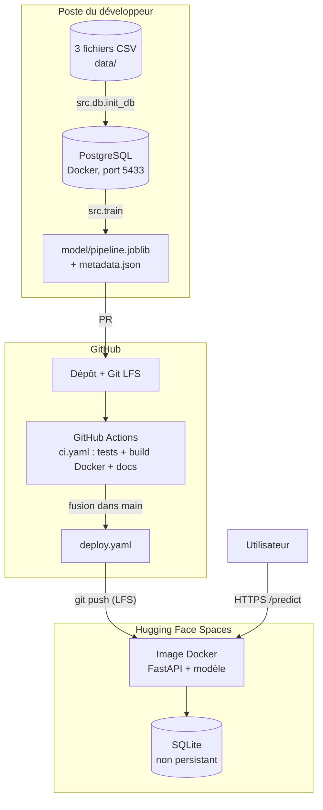
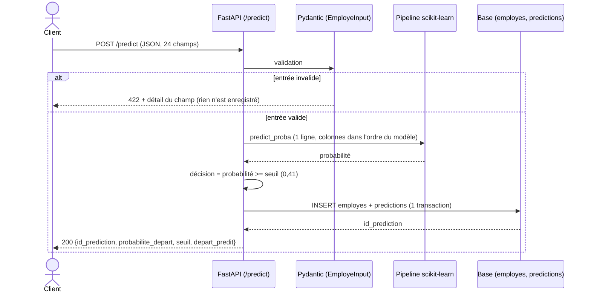
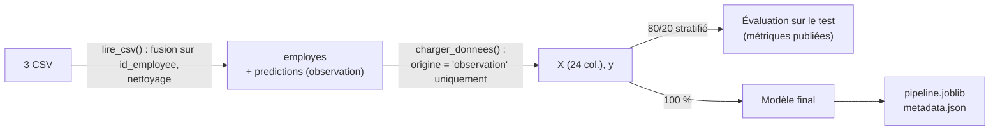
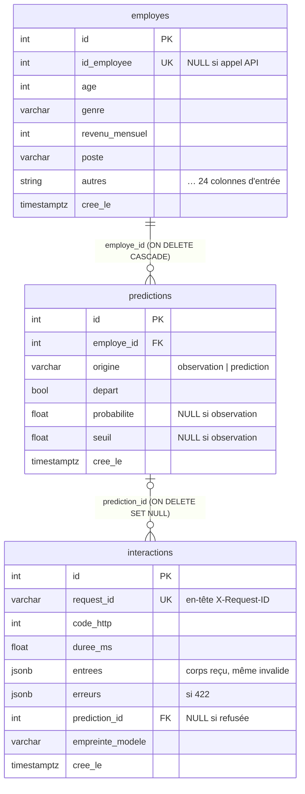

# Architecture

## Vue d'ensemble



## Composants

| Composant | Emplacement | Rôle |
|---|---|---|
| API | `app/main.py` | Routes FastAPI, démarrage (chargement du modèle, création des tables) |
| Schémas | `app/schemas.py` | Validation des entrées/sorties (Pydantic), exemple Swagger |
| Chargement du modèle | `app/model.py` | Lecture unique du `.joblib` (cache), `MODEL_PATH`, empreinte |
| Logs | `app/logs.py` | Logs JSON, `request_id` ajouté à chaque ligne |
| Traçabilité | `app/tracabilite.py` | Middleware (`X-Request-ID`, durée), journal `interactions`, `GET /logs` |
| Features | `src/features.py` | Listes de colonnes (source de vérité) et features créées |
| Entraînement | `src/train.py` | Lecture en base, pipeline, évaluation, export |
| Base de données | `src/db/` | Modèles ORM, connexion, chargement du jeu initial |
| SQL | `sql/` | Schéma PostgreSQL, réinitialisation, requêtes de consultation |
| Modèle | `model/` | Pipeline exporté (Git LFS) et métadonnées |
| Tests | `tests/{unit,integration,functional}/` | 3 catégories, voir [Tests](tests.md) |
| CI/CD | `.github/workflows/` | `ci.yaml` (tests, Docker, docs), `deploy.yaml` (Hugging Face) |
| Documentation | `docs/`, `mkdocs.yml`, `sphinx/` | Ce site (MkDocs) et la référence du code (Sphinx) |

## Flux d'une prédiction



## Flux d'entraînement



## Modèle de données



Règles garanties **par la base** (contraintes) :

- une observation n'a ni probabilité ni seuil, une prédiction a les deux ;
- probabilité comprise entre 0 et 1 ;
- un seul départ observé par employé (index unique partiel) ;
- supprimer un employé supprime ses prédictions.

Le schéma PostgreSQL est défini dans `sql/01_schema.sql` ; les modèles ORM
(`src/db/models.py`) en sont le miroir, et un test vérifie que les colonnes coïncident.

## Environnements

| | Local (développement) | CI (GitHub Actions) | Production (Hugging Face) |
|---|---|---|---|
| Base | PostgreSQL 17 (Docker Compose) | PostgreSQL 17 (service) | SQLite dans le conteneur |
| Persistance | Volume Docker `pgdata` | Aucune (jetable) | Aucune (perdue au redémarrage) |
| Lancement | `docker compose up` | automatique (push, PR) | automatique (fusion dans `main`) |

## Arborescence

```text
turnover_model/
├── app/                  # API FastAPI
│   ├── main.py           #   routes /, /health, /predict
│   ├── schemas.py        #   entrées / sorties (Pydantic)
│   └── model.py          #   chargement du modèle
├── src/
│   ├── features.py       # colonnes + features créées
│   ├── train.py          # entraînement depuis la base, export
│   └── db/               # ORM, connexion, chargement des CSV
├── sql/                  # schéma PostgreSQL, reset, requêtes
├── model/                # pipeline.joblib (LFS) + metadata.json
├── data/                 # 3 CSV sources
├── notebooks/            # analyse exploratoire et modélisation
├── tests/                # unit / integration / functional
├── docs/  mkdocs.yml     # documentation MkDocs (ce site)
├── sphinx/               # référence du code (Sphinx)
├── scripts/              # export du schéma OpenAPI
├── .github/workflows/    # ci.yaml, deploy.yaml
├── Dockerfile  docker-compose.yml
└── requirements.txt  requirements-docs.txt
```
