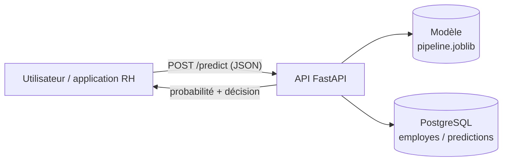

# Turnover API

Prédiction du **risque de départ des employés**, exposée par une API REST.

Un modèle de Machine Learning (Random Forest) estime, à partir du profil RH d'un
employé (SIRH, sondage interne, évaluations), la probabilité qu'il quitte
l'entreprise. L'API renvoie cette probabilité et une décision (départ prédit ou non),
et **enregistre chaque prédiction** en base de données.

## Par où commencer ?

| Vous êtes… | Lisez |
|---|---|
| **Utilisateur** de l'API | [Utiliser l'API](utilisation.md), puis la [référence Swagger](api/index.md) |
| **Data scientist** | [Fiche technique du modèle](modele.md) et [performances](performances.md) |
| **Développeur** | [Installation](installation.md), [architecture](architecture.md), [choix techniques](choix-techniques.md), [tests](tests.md) |
| **Mainteneur** | [Maintenance et mises à jour](maintenance.md), [déploiement](deploiement.md) |

## En bref

| | |
|---|---|
| Modèle | Random Forest (scikit-learn 1.9.1), 300 arbres de profondeur 4 |
| Entrées | 24 caractéristiques d'un employé |
| Sortie | Probabilité de départ, seuil (0,41), décision |
| Performances (test) | ROC AUC 0,77 · 81 % des départs détectés · 29 % des alertes justifiées |
| API | FastAPI, Swagger UI sur `/docs` |
| Base de données | PostgreSQL (local, Docker), SQLite en repli |
| Déploiement | Docker sur Hugging Face Spaces, CI/CD GitHub Actions |

!!! warning "Usage prévu"
    Le modèle est un **outil d'aide à la décision** pour cibler des actions de
    rétention. Il ne doit pas fonder seul une décision individuelle concernant un
    employé. Voir les [limites du modèle](modele.md#limites-et-precautions).

## Outils de documentation

| Outil | Rôle |
|---|---|
| **Swagger** (OpenAPI) | Documentation interactive de l'API, générée par FastAPI (`/docs`) et intégrée [ici](api/index.md) |
| **Markdown** | Toutes les pages de ce site, et le `README.md` du dépôt |
| **MkDocs** (thème Material) | Ce site : guides, fiche du modèle, architecture, maintenance |
| **Sphinx** (autodoc) | [Référence du code](reference.md), générée depuis les docstrings |
