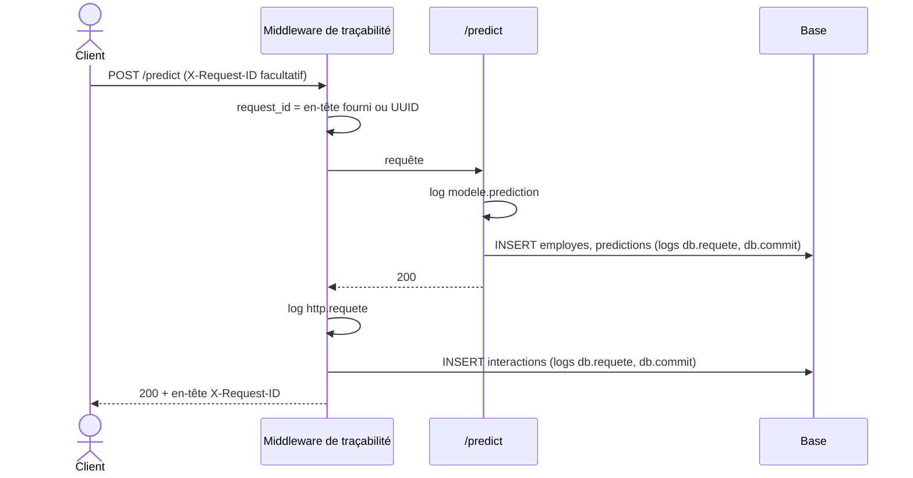

# Logs et traçabilité

Deux niveaux de traces, reliés par un même **identifiant de requête** (`request_id`) :

| | Logs techniques | Journal des interactions |
|---|---|---|
| **Quoi** | Requêtes HTTP, appels au modèle, requêtes SQL, transactions, erreurs | Chaque appel à `/predict` : entrées, résultat, erreurs, durée, client |
| **Où** | Sortie standard (une ligne JSON par événement), fichier en option | Table `interactions` de la base |
| **Lire** | `docker compose logs api`, onglet **Logs** du Space, fichier `LOG_FILE` | `GET /logs` (rôle auditeur ou admin), SQL (`sql/04_journal.sql`) |
| **Pour** | Diagnostiquer, mesurer, suivre une requête dans l'API et la base | Auditer l'usage du modèle, rejouer une prédiction, analyser les refus |
| **Durée** | Selon l'hébergeur (le Space ne conserve que les logs récents) | 12 mois (voir [Conservation](#conservation-et-donnees-personnelles)) |



## Identifiant de requête

- Chaque réponse contient l'en-tête **`X-Request-ID`**.
- Un client peut fournir le sien (`X-Request-ID: appel-rh-0042`, 64 caractères max.,
  lettres, chiffres, `.`, `_`, `-`) : il est repris tel quel, sinon un UUID est généré.
- Le même identifiant figure dans **toutes** les lignes de log de la requête et dans la
  table `interactions` : on retrouve tout le parcours d'un appel à partir de la réponse.

## Logs techniques

Une ligne JSON par événement, par exemple :

```json
{"horodatage": "2026-11-17T02:32:53.182+00:00", "niveau": "INFO", "logger": "turnover.api",
 "message": "prédiction calculée", "request_id": "demo-001", "evenement": "modele.prediction",
 "probabilite": 0.6367, "seuil": 0.41, "depart_predit": true, "duree_ms": 9.8,
 "empreinte_modele": "39994109fb48"}
```

| Événement | Logger | Contenu |
|---|---|---|
| `api.demarrage`, `api.arret` | `turnover.api` | Version de l'API |
| `modele.chargement` | `turnover.modele` | Chemin, empreinte, seuil du modèle |
| `db.configuration`, `db.schema` | `turnover.db` | Type de base, adresse (sans mot de passe) |
| `http.requete` | `turnover.api` | Méthode, route, code HTTP, durée, client |
| `http.validation` | `turnover.api` | Champs refusés (422) |
| `http.erreur` | `turnover.api` | Exception non gérée, avec la pile d'appels |
| `modele.prediction` | `turnover.api` | Probabilité, seuil, décision, durée du calcul |
| `db.requete` | `turnover.db` | Texte SQL, durée, lignes concernées |
| `db.commit`, `db.rollback` | `turnover.db` | Validation ou annulation d'une transaction |
| `db.erreur` | `turnover.db` | Type d'erreur, requête en cause |
| `interaction.erreur` | `turnover.api` | Échec de l'écriture du journal (la réponse n'est pas affectée) |
| `logs.consultation`, `logs.acces_refuse` | `turnover.api` | Consultation de `/logs`, tentative refusée |

!!! info "Données sensibles"
    Les **valeurs** des paramètres SQL ne sont jamais écrites dans les logs techniques
    (seul le texte de la requête, avec ses marqueurs, l'est) : les données RH restent en
    base. Un test le vérifie.

### Lire les logs techniques

=== "Docker Compose"

    ```bash
    docker compose logs -f api
    docker compose logs api --no-log-prefix | grep '"demo-001"'   # une requête
    ```

=== "Hugging Face"

    Onglet **Logs** du Space (logs récents uniquement).

=== "Fichier"

    Définir `LOG_FILE` (ex. `/home/user/logs/api.log`) : rotation automatique,
    5 fichiers de 5 Mo. Chaque ligne est un JSON, exploitable avec `jq` :

    ```bash
    jq 'select(.evenement == "http.requete" and .code_http >= 400)' api.log
    ```

### Configuration

| Variable | Défaut | Rôle |
|---|---|---|
| `LOG_LEVEL` | `INFO` | Niveau minimal (`DEBUG`, `INFO`, `WARNING`, `ERROR`) |
| `LOG_FILE` | *(aucun)* | Écrit aussi les logs dans ce fichier |

Les logs d'accès d'uvicorn sont désactivés (`--no-access-log`) : ils feraient doublon
avec `http.requete`, qui contient en plus le `request_id` et la durée.

## Journal des interactions (table `interactions`)

Un appel à `/predict` = une ligne, **qu'il réussisse ou non** :

| Colonne | Contenu |
|---|---|
| `request_id` | Identifiant de la requête (unique) |
| `cree_le` | Date et heure |
| `methode`, `route`, `code_http`, `duree_ms` | Requête HTTP et résultat |
| `client`, `user_agent` | Adresse IP et logiciel du client |
| `utilisateur` | Compte authentifié à l'origine de l'appel (vide si non authentifié) |
| `entrees` | Corps reçu (JSON), **même invalide** ; jamais conservé pour un appel non authentifié |
| `erreurs` | Détail de validation (si 422) |
| `prediction_id` | Prédiction produite (clé étrangère vers `predictions`, NULL si refusée) |
| `version_api`, `empreinte_modele` | Version de l'API et modèle exact utilisé |

L'**empreinte du modèle** (12 premiers caractères du SHA-256 de `pipeline.joblib`) permet
de savoir quel modèle a produit chaque prédiction, même après un réentraînement.

Si l'écriture du journal échoue, la réponse à l'utilisateur n'est pas affectée ;
l'échec est signalé dans les logs techniques (`interaction.erreur`).

### Consulter : `GET /logs`

Réservé aux rôles **auditeur** et **admin** (voir [Sécurité](securite.md#roles-et-droits)) :

| Situation | Réponse |
|---|---|
| Sans jeton, jeton invalide ou expiré | `401` |
| Rôle `rh` | `403` |
| Rôle `auditeur` ou `admin` | `200` + page de résultats |

```bash
curl "http://localhost:7860/logs?limit=20&code_http=422" -H "Authorization: Bearer <jeton>"
```

| Paramètre | Rôle |
|---|---|
| `limit` (1 à 500, défaut 50), `offset` | Pagination, du plus récent au plus ancien |
| `code_http` | Ex. `422` pour les refus |
| `request_id` | Retrouver un appel précis |
| `depuis` | Date ISO 8601 minimale (ex. `2026-11-01T00:00:00Z`) |
| `avec_entrees` | `true` pour inclure les données envoyées (masquées par défaut) |

```json
{
  "total": 1, "limit": 50, "offset": 0,
  "items": [{
    "id": 1, "request_id": "demo-001", "cree_le": "2026-11-17T02:32:53.222Z",
    "methode": "POST", "route": "/predict", "code_http": 200, "duree_ms": 89.65,
    "client": "172.18.0.1", "user_agent": "curl/7.87.0", "prediction_id": 1473,
    "version_api": "1.0.0", "empreinte_modele": "39994109fb48",
    "utilisateur": "marie.rh", "erreurs": null, "entrees": null
  }]
}
```

Dans Swagger (`/docs`) : bouton **Authorize** (identifiant et mot de passe d'un
auditeur), puis *Try it out* sur `GET /logs`.

### Consulter en SQL

`sql/04_journal.sql` : derniers appels, codes HTTP et durées (moyenne, 95e percentile),
champs les plus refusés, parcours complet d'une requête, purge.

```bash
docker compose exec -T db sh -c 'psql -U "$POSTGRES_USER" -d "$POSTGRES_DB"' < sql/04_journal.sql
```

## Conservation et données personnelles

Le journal contient des **données personnelles** : profil RH envoyé, adresse IP.

- Durée de conservation proposée : **12 mois**, puis purge (requête 5 de
  `sql/04_journal.sql`, à intégrer à la [revue mensuelle](maintenance.md#suivi-mensuel)).
  À valider avec le DPO.
- Accès restreint : rôles `auditeur` et `admin` uniquement, données d'entrée masquées par défaut
  dans `/logs` ; en base, le rôle `turnover_auditeur` ne voit ni `entrees` ni `client`.
- Supprimer une prédiction ne supprime pas sa trace : `prediction_id` devient NULL
  (`ON DELETE SET NULL`), le reste de la ligne est conservé pour l'audit.
- Sur Hugging Face (SQLite non persistant), le journal est perdu au redémarrage du Space.
