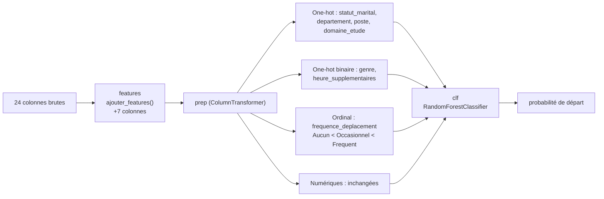

# Fiche technique du modèle

| | |
|---|---|
| Tâche | Classification binaire : l'employé va-t-il quitter l'entreprise ? |
| Algorithme | `RandomForestClassifier` (scikit-learn 1.9.1) |
| Fichier | `model/pipeline.joblib` (≈ 280 Ko, Git LFS) + `model/metadata.json` |
| Entraîné sur | 1 470 employés, 16,1 % de départs |
| Seuil de décision | 0,41 |
| Code | `src/features.py`, `src/train.py` ; analyse d'origine : `notebooks/turnover_modeling.ipynb` |

## Données

Trois extraits RH, fusionnés sur l'identifiant de l'employé (1 470 employés présents
dans les trois fichiers, aucun doublon, aucune valeur manquante) :

| Fichier | Contenu | Identifiant |
|---|---|---|
| `extrait_sirh.csv` | Profil : âge, genre, revenu, poste, ancienneté... | `id_employee` (`1`) |
| `extrait_sondage.csv` | Sondage interne + **cible** `a_quitte_l_entreprise` | `code_sondage` (`000001`) |
| `extrait_eval.csv` | Évaluations, satisfactions, heures supplémentaires | `eval_number` (`E_1`) |

Les données sont chargées dans PostgreSQL (`python -m src.db.init_db`) ; l'entraînement
lit la base, pas les CSV. Les prédictions faites par l'API ne servent **jamais** à
l'entraînement (seules les lignes `origine = 'observation'` sont lues).

### Nettoyage

| Étape | Colonnes | Raison |
|---|---|---|
| Suppression | `nombre_heures_travailless`, `nombre_employee_sous_responsabilite`, `ayant_enfants` | Constantes (même valeur pour tous) |
| Suppression | `niveau_hierarchique_poste`, `note_evaluation_actuelle`, `annees_dans_l_entreprise` | Fortement corrélées à d'autres variables |
| Conversion | `augementation_salaire_precedente` | `"11 %"` → `11` |

Il reste **24 colonnes d'entrée** : 17 numériques et 7 catégorielles.

## Features créées

Calculées **dans le pipeline** (`src/features.py`) : l'API reçoit les colonnes brutes.

| Feature | Formule | Intuition |
|---|---|---|
| `satisfaction_moyenne` | moyenne des 4 satisfactions | Satisfaction globale |
| `satisfaction_min` | minimum des 4 satisfactions | Un point de mécontentement fort suffit |
| `revenu_par_annee_exp` | revenu / (expérience totale + 1) | Rémunération rapportée à l'expérience |
| `taux_mobilite` | expériences précédentes / (expérience totale + 1) | Habitude de changer d'employeur |
| `age_debut_carriere` | âge − expérience totale | Parcours (études longues, reconversion) |
| `part_poste_sans_promo` | années sans promotion / (années dans le poste + 1) | Stagnation |
| `surcharge` | heures sup. = Oui **et** déplacements fréquents | Charge cumulée |

Le `+ 1` évite la division par zéro pour un débutant ou un nouvel arrivant dans le poste.

## Pipeline



- Pas de mise à l'échelle des variables numériques : inutile pour des arbres.
- `OneHotEncoder(handle_unknown="ignore")` : une modalité inconnue ne fait pas planter
  le modèle ; l'API refuse de toute façon les valeurs non vues à l'entraînement.
- Le pipeline complet est exporté en **un seul objet** : impossible d'appliquer en
  production un prétraitement différent de celui de l'entraînement.

## Hyperparamètres

| Paramètre | Valeur | Raison |
|---|---|---|
| `n_estimators` | 300 | Stabilité des probabilités |
| `max_depth` | 4 | Arbres peu profonds : limite le surapprentissage |
| `min_samples_leaf` | 20 | Feuilles d'au moins 20 employés : idem |
| `max_features` | `"sqrt"` | Décorrèle les arbres |
| `class_weight` | `"balanced_subsample"` | Compense le déséquilibre (16 % de départs) |
| `random_state` | 42 | Reproductibilité |

Choisis dans le notebook par **recherche sur grille** (validation croisée stratifiée à
5 plis, métrique : PR AUC), avec la **règle d'un écart-type** : parmi les combinaisons
dont le score n'est pas significativement inférieur au meilleur, la plus régularisée est
retenue. Sans cette régularisation, la forêt apprenait le jeu d'entraînement par cœur
(score parfait en entraînement, voir [Performances](performances.md#modeles-de-reference)).

## Seuil de décision : 0,41

Pour l'entreprise, **rater un départ coûte plus cher qu'une fausse alerte** (un entretien
de rétention inutile). Le seuil maximise donc le **F2**, qui accorde deux fois plus de
poids au rappel (départs détectés) qu'à la précision (alertes justifiées).

Il a été calculé sur les prédictions *hors pli* de la validation croisée, jamais sur le
jeu de test. Il est stocké dans le modèle exporté et renvoyé par l'API.

## Entraînement et export

```bash
python -m src.db.init_db   # si la base est vide
python -m src.train
```

1. Lecture des données en base, triées par `id_employee` (ordre identique aux CSV).
2. Découpage 80/20 stratifié (`random_state=42`), entraînement, **évaluation sur le test**.
3. **Réentraînement sur les 1 470 lignes**, puis export.

Le modèle exporté est donc entraîné sur toutes les données ; les métriques publiées
viennent de l'étape 2. `model/metadata.json` contient seuil, colonnes, hyperparamètres,
métriques, source des données et versions des bibliothèques.

## Variables les plus influentes

Trois méthodes comparées dans le notebook (importance native, permutation, SHAP) ;
variables classées par rang moyen :

| Rang | Variable | Constat dans les données |
|---|---|---|
| 1 | `heure_supplementaires` | 30,5 % de départs avec heures sup., 10,4 % sans |
| 2 | `revenu_mensuel` | Revenu moyen des partis : 4 787, des restés : 6 833 |
| 3 | `nombre_participation_pee` | 0,5 participation en moyenne chez les partis, 0,8 chez les restés |
| 4 | `age` | Âge moyen des partis : 33,6 ans, des restés : 37,6 ans |
| 5 | `statut_marital` | 25,5 % de départs chez les célibataires, 12,5 % chez les mariés |
| 6 | `satisfaction_min` | Feature créée : un mécontentement fort compte |

`taux_mobilite` (feature créée) est la plus utilisée par la forêt (importance native et
SHAP), mais la permutation ne confirme pas son effet sur le test : les importances
natives surestiment les variables continues très corrélées entre elles.

## Limites et précautions

!!! warning "À lire avant tout usage"

- **Précision faible** : environ 7 alertes sur 10 sont des fausses alertes. Le modèle sert
  à **prioriser** des échanges, pas à juger une personne.
- **Petit jeu de données** : 1 470 employés, dont 237 départs ; 47 départs seulement dans
  le jeu de test. Les métriques varient sensiblement d'un échantillon à l'autre
  (écart-type du ROC AUC en validation croisée : 0,025).
- **Variables sensibles** : `genre` et `statut_marital` font partie des entrées. `genre`
  a une influence quasi nulle (dernier rang), mais `statut_marital` pèse dans la
  décision. Leur usage doit être validé au regard du RGPD et de la non-discrimination ;
  un réentraînement sans ces variables est une piste (voir la [feuille de route](maintenance.md#feuille-de-route)).
- **Données figées** : le modèle reflète l'entreprise au moment de l'extraction. Une
  évolution (politique salariale, télétravail, réorganisation) peut dégrader ses
  performances sans erreur visible : d'où le [protocole de maintenance](maintenance.md).
- **Modalités figées** : un nouveau poste ou département est refusé par l'API tant que
  le modèle n'a pas été réentraîné avec.
- **Pas d'explication par prédiction** dans l'API : l'analyse SHAP existe dans le
  notebook, mais n'est pas exposée.
