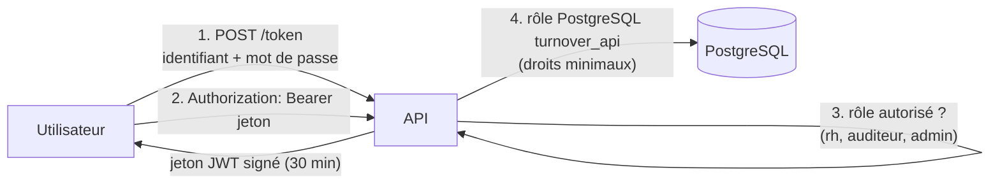

# Sécurité et gestion des accès

Le service manipule des **données RH personnelles** (profil, rémunération, satisfaction).
La sécurité repose sur trois couches indépendantes : si l'une est contournée, les
autres limitent les dégâts (*défense en profondeur*).



| Couche | Protège contre | Mécanisme |
|---|---|---|
| **Authentification** | Accès anonyme | Comptes, mots de passe hachés (Argon2id), jetons JWT |
| **Autorisation (API)** | Un utilisateur qui dépasse son rôle | Rôles `rh`, `auditeur`, `admin` vérifiés à chaque requête |
| **Droits en base** | Une faille dans l'API, un script compromis | Rôles PostgreSQL à privilèges minimaux |

## Authentification de l'API

### Méthode : OAuth2 *password* + jeton JWT

1. Le client envoie identifiant et mot de passe à `POST /token` (formulaire OAuth2).
2. L'API vérifie le mot de passe et renvoie un **jeton JWT** signé (HS256), valable
   **30 minutes** (`JWT_DUREE_MINUTES`).
3. Le client l'envoie ensuite dans l'en-tête `Authorization: Bearer <jeton>`.

```bash
# 1. Obtenir un jeton
curl -X POST http://localhost:7860/token \
     --data-urlencode "username=marie.rh" --data-urlencode "password=..."
# {"access_token": "eyJhbGciOi...", "token_type": "bearer", "expires_in": 1800}

# 2. L'utiliser
curl -X POST http://localhost:7860/predict -H "Authorization: Bearer eyJhbGciOi..." \
     -H "Content-Type: application/json" --data-binary @employe.json
```

Dans **Swagger** (`/docs`) : bouton **Authorize**, saisir identifiant et mot de passe ;
Swagger obtient et envoie le jeton automatiquement.

| Propriété du jeton | Choix |
|---|---|
| Contenu | `sub` (identifiant), `role`, `iss` (`turnover-api`), `iat`, `exp` ; **aucune donnée sensible** (un JWT est lisible par tous, seulement infalsifiable) |
| Signature | HS256 avec `JWT_SECRET` (≥ 32 caractères) ; seul l'algorithme HS256 est accepté (`alg: none` refusé) |
| Vérifications | Signature, expiration, émetteur, champs obligatoires |
| Révocation | Le compte est **relu en base à chaque requête** : un compte désactivé ou dont le rôle change perd ses droits immédiatement, même avec un jeton encore valide |

Pourquoi des jetons plutôt qu'une clé d'API ? Les jetons expirent, sont liés à une
personne (traçabilité dans le journal), et le mot de passe ne circule qu'une fois.

### Rôles et droits

| Route | Public | `rh` | `auditeur` | `admin` |
|---|:-:|:-:|:-:|:-:|
| `GET /health`, `/docs`, `/redoc` | ✅ | ✅ | ✅ | ✅ |
| `POST /token` | ✅ | ✅ | ✅ | ✅ |
| `GET /moi` | | ✅ | ✅ | ✅ |
| `POST /predict` | | ✅ | | ✅ |
| `GET /logs` | | | ✅ | ✅ |

- **401** : non authentifié (jeton absent, invalide, expiré ; compte désactivé).
- **403** : authentifié, mais rôle insuffisant.

La matrice est testée (`tests/unit/test_auth.py`, `tests/functional/test_authentification.py`).

### Mots de passe

| Règle | Détail |
|---|---|
| **Hachage Argon2id** | Algorithme recommandé par l'OWASP, résistant aux attaques par GPU ; sel aléatoire par mot de passe. Seule l'empreinte est stockée (`$argon2id$v=19$m=65536,t=3,p=4$...`). |
| **Contrainte en base** | `ck_utilisateurs_hash` : la base refuse toute valeur qui n'est pas une empreinte Argon2id (un mot de passe en clair ne peut pas être stocké, même par erreur). |
| **Politique** | 12 caractères minimum, au moins 3 types parmi minuscules, majuscules, chiffres, symboles. |
| **Verrouillage** | 5 échecs → compte verrouillé 15 minutes (attaques par force brute). |
| **Pas d'énumération** | Même message et même durée de réponse que l'identifiant existe ou non (vérification d'une empreinte factice). La raison exacte n'est que dans les logs serveur. |
| **Jamais dans les logs** | Ni le mot de passe, ni le jeton (testé). La connexion n'est pas enregistrée dans le journal des interactions. |
| **Jamais en argument** | La ligne de commande lit le mot de passe sans écho, ou dans une variable d'environnement : il ne reste pas dans l'historique du terminal. |

### Gérer les comptes

Les comptes se gèrent **en ligne de commande**, avec la connexion administrateur
(`ADMIN_DATABASE_URL`) : il n'existe volontairement aucune route d'API pour créer un
compte ou changer un rôle.

```bash
python -m app.utilisateurs creer marie.rh --role rh          # mot de passe demandé sans écho
python -m app.utilisateurs creer paul.audit --role auditeur
python -m app.utilisateurs lister
python -m app.utilisateurs mot-de-passe marie.rh
python -m app.utilisateurs deverrouiller marie.rh
python -m app.utilisateurs desactiver marie.rh                # départ, mobilité...
```

Sur Hugging Face (SQLite non persistant), un compte `admin` est recréé à chaque
démarrage à partir des secrets `ADMIN_USERNAME` / `ADMIN_PASSWORD`.

## Gestion fine des accès à la base

Chaque programme se connecte avec **son propre rôle PostgreSQL**, limité à ce dont il a
besoin (`sql/05_roles.sql`, appliqué par `python -m src.db.init_db`) :

| Rôle | Utilisé par | Variable |
|---|---|---|
| propriétaire (`POSTGRES_USER`) | `init_db`, gestion des comptes | `ADMIN_DATABASE_URL` |
| `turnover_api` | l'API | `DATABASE_URL` |
| `turnover_ml` | l'entraînement (`src.train`) | `ML_DATABASE_URL` |
| `turnover_auditeur` | un analyste, un contrôle | (connexion manuelle) |

| Table / colonne | `turnover_api` | `turnover_ml` | `turnover_auditeur` |
|---|---|---|---|
| `employes` | INSERT, SELECT `id`, `cree_le` | SELECT | — |
| `predictions` | INSERT, SELECT `id`, `cree_le` | SELECT | SELECT |
| `interactions` | INSERT, SELECT | — | SELECT **sauf** `entrees`, `client`, `user_agent` |
| `utilisateurs` | SELECT, UPDATE `echecs_connexion`, `verrouille_jusqu_a`, `derniere_connexion` | — | — |
| Créer / supprimer des tables | — | — | — |

Ce que cela garantit, **même si l'API est compromise** :

- elle ne peut **ni modifier ni supprimer** une prédiction ou une ligne du journal
  (piste d'audit en ajout seul) ;
- elle ne peut pas **relire les données RH** déjà enregistrées ;
- elle ne peut ni **créer un compte**, ni **changer un rôle ou un mot de passe** ;
- l'entraînement ne peut **rien écrire** ;
- l'auditeur voit les résultats et le journal, **sans les données personnelles**.

Chaque droit et chaque refus sont vérifiés sur un vrai PostgreSQL en CI
(`tests/integration/test_securite_db.py`).

Autres mesures :

- mots de passe des rôles stockés par PostgreSQL en empreinte **SCRAM-SHA-256** ;
  `ALTER ROLE ... PASSWORD` passe par la connexion brute du pilote et n'apparaît donc pas
  dans les logs SQL de l'application ;
- base exposée sur **127.0.0.1** uniquement (`docker-compose.yml`), pas sur le réseau ;
- délai de connexion borné (10 s) ;
- requêtes SQL **paramétrées** par l'ORM : pas d'injection SQL possible depuis les entrées.

## Secrets

| Secret | Usage | Où le définir |
|---|---|---|
| `POSTGRES_PASSWORD` | Compte propriétaire de la base | `.env` |
| `TURNOVER_API_DB_PASSWORD`, `TURNOVER_ML_DB_PASSWORD`, `TURNOVER_AUDITEUR_DB_PASSWORD` | Rôles applicatifs | `.env` |
| `JWT_SECRET` | Signature des jetons | `.env` ; secret du Space |
| `ADMIN_USERNAME`, `ADMIN_PASSWORD` | Compte admin initial (SQLite uniquement) | secrets du Space |
| `HF_TOKEN` | Déploiement | secret GitHub |

Règles :

- **Aucun secret dans le code ni dans le dépôt.** `.env` est ignoré par Git ; seul
  `.env.example` (valeurs à remplacer) est versionné. Le code n'a **aucune valeur par
  défaut** pour les connexions : sans configuration, il s'arrête avec un message clair.
- **Valeurs aléatoires** : `python -c "import secrets; print(secrets.token_urlsafe(32))"`.
- **Un secret par usage** : une fuite n'en compromet qu'un.
- **Secrets de plateforme** pour GitHub et Hugging Face (chiffrés, masqués dans les logs).
- **Rotation** : voir [Maintenance](maintenance.md#securite).
- Activer la **protection contre la publication de secrets** de GitHub
  (*Settings → Code security → Secret scanning / Push protection*).

```bash
cp .env.example .env     # puis remplacer chaque "a-remplacer"
```

## Protection des échanges

| Mesure | Détail |
|---|---|
| **HTTPS** | Assuré par Hugging Face en production ; en-tête `Strict-Transport-Security` |
| **En-têtes de sécurité** | Partout : `X-Content-Type-Options: nosniff`, `Referrer-Policy: no-referrer`, `Permissions-Policy`. Réponses de l'API : `Content-Security-Policy: default-src 'none'; frame-ancestors 'none'`, `X-Frame-Options: DENY` et `Cache-Control: no-store` (données RH et jetons jamais en cache, jamais dans un cadre). Documentation (`/`, `/docs`, `/redoc`) : `frame-ancestors 'self' https://huggingface.co`, pour que l'onglet *App* du Space puisse l'afficher (origines modifiables avec `FRAME_ANCESTORS`) |
| **CORS** | Non activé : aucun site tiers ne peut appeler l'API depuis un navigateur |
| **Validation stricte** | Schémas Pydantic (listes fermées, bornes, champs inconnus refusés) |
| **Erreurs** | Messages génériques côté client ; détails uniquement dans les logs serveur |

## Données personnelles (RGPD)

| Principe | Mise en œuvre |
|---|---|
| Minimisation | Pas de nom ni d'identifiant RH dans `employes` pour les appels de l'API ; données d'un appel **non authentifié** jamais conservées |
| Confidentialité | Accès par rôle (API et base) ; `entrees` masqué par défaut dans `/logs` ; auditeur sans accès aux données RH |
| Traçabilité | Chaque appel associé à un compte (`interactions.utilisateur`) |
| Conservation | Journal purgé au-delà de 12 mois (à valider avec le DPO) |
| Variables sensibles | `genre`, `statut_marital` : voir les [limites du modèle](modele.md#limites-et-precautions) |

## Contrôles automatiques (CI)

| Contrôle | Outil |
|---|---|
| Vulnérabilités connues des dépendances | `pip-audit` (job *Security audit*) |
| Analyse statique du code (secrets en dur, injections...) | `bandit` |
| Mises à jour de sécurité | Dependabot (PR hebdomadaires) |
| Authentification, rôles, verrouillage, en-têtes | tests unitaires et fonctionnels |
| Droits réels des rôles PostgreSQL | tests d'intégration (`TEST_ROLES_PG=1`) |

## Menaces couvertes

| Menace | Parade |
|---|---|
| Accès anonyme aux prédictions ou au journal | Authentification obligatoire (401) |
| Utilisateur qui dépasse ses droits | Rôles vérifiés à chaque requête (403) |
| Vol de la base des comptes | Empreintes Argon2id, pas de mots de passe |
| Force brute sur un compte | Verrouillage après 5 échecs |
| Découverte des comptes existants | Réponse identique (message et durée) |
| Jeton volé | Expiration 30 min ; désactivation immédiate du compte |
| Jeton falsifié ou non signé | Signature vérifiée, `alg: none` refusé |
| Injection SQL | Requêtes paramétrées (ORM) |
| API compromise | Rôle `turnover_api` : ni modification, ni suppression, ni lecture des données RH |
| Fuite de secrets par le dépôt | `.env` ignoré, aucune valeur par défaut, bandit, secret scanning |
| Dépendance vulnérable | pip-audit en CI, Dependabot |
| Base exposée sur le réseau | Écoute sur 127.0.0.1 uniquement |

## Limites connues

- **Hugging Face** : base SQLite non persistante ; le Space est public (seules les routes
  `health` et documentation sont accessibles sans compte).
- Pas de **limitation du nombre de requêtes** par client au-delà du verrouillage des
  comptes (à confier à un reverse proxy en production).
- Pas de **révocation individuelle de jeton** avant expiration (désactiver le compte, ou
  changer `JWT_SECRET` pour invalider tous les jetons).
- Pas de **double authentification** ni d'annuaire d'entreprise (SSO/OIDC) : à prévoir
  pour un usage à grande échelle.
- **Chiffrement au repos** de la base : à la charge de l'hébergeur.

## Liste de contrôle avant mise en production

- [ ] `.env` créé, toutes les valeurs remplacées par des valeurs aléatoires.
- [ ] `JWT_SECRET` défini (≥ 32 caractères) partout où l'API tourne.
- [ ] `python -m src.db.init_db` lancé (rôles appliqués avec leurs mots de passe).
- [ ] Comptes nominatifs créés, un par personne ; pas de compte partagé.
- [ ] Secrets du Space définis : `JWT_SECRET`, `ADMIN_USERNAME`, `ADMIN_PASSWORD`.
- [ ] Protection de `main` et *Push protection* activées sur GitHub.
- [ ] Job *Security audit* vert.
